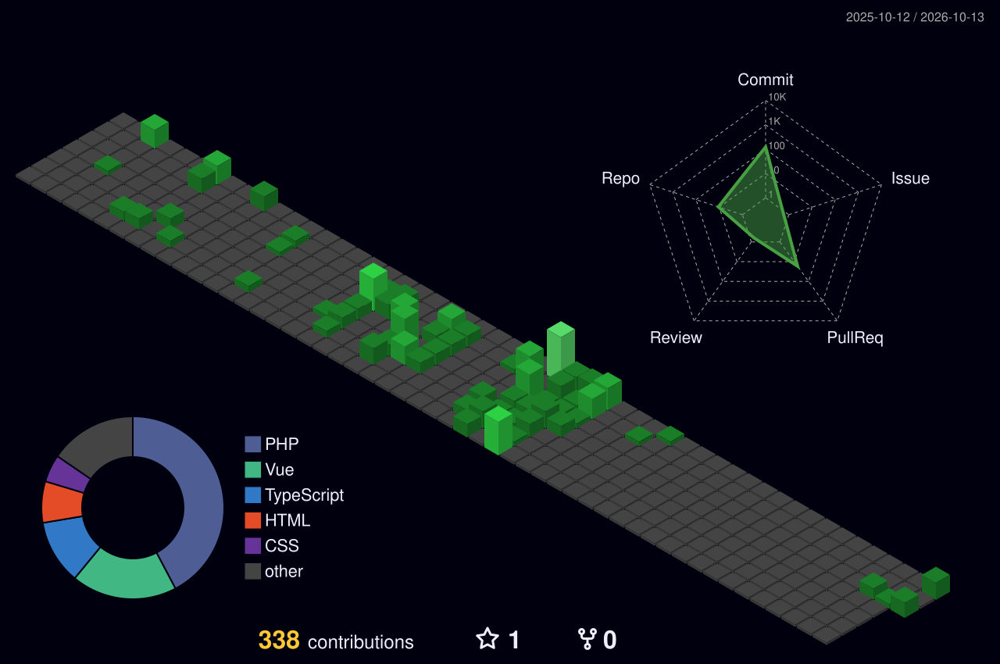

  <!-- Banner animado (Lain) -->
  

<h1 align="center">Hola, soy Nieto</h1>

  

  
  
  

---

## Sobre mí

Soy técnico informático y estoy terminando el ciclo de **Desarrollo de Aplicaciones Web**, después de sacarme el de **Sistemas Microinformáticos y Redes**. Me muevo entre los dos mundos: lo mismo monto y configuro un equipo que levanto una aplicación de principio a fin.

- Experiencia en **soporte técnico**, montaje de equipos y redes en entornos Windows y Linux.
- Desarrollo **full-stack** y diseño de interfaces para la **administración pública**.
- Me gusta resolver problemas reales con código y mejorar un poco cada día.
- Hablo **español** (nativo) e **inglés** (nivel intermedio).

---

## Tecnologías

<table>
  <tr>
    <td><b>Lenguajes</b></td>
    <td>
      
      
      
      
    </td>
  </tr>
  <tr>
    <td><b>Frontend</b></td>
    <td>
      
      
      
      
      
      
    </td>
  </tr>
  <tr>
    <td><b>Bases de datos</b></td>
    <td>
      
      
    </td>
  </tr>
  <tr>
    <td><b>Sistemas y herramientas</b></td>
    <td>
      
      
      
      
      
    </td>
  </tr>
</table>

**Soft skills:** trabajo en equipo · resolución de problemas · aprendizaje rápido · comunicación · organización · adaptabilidad

---

## Estadísticas

  
  

  

---

## Contribuciones

  

  

---

## Contacto

  
  

  <i>Resolver problemas reales mediante código y mejora continua.</i>

