<!-- Banner animado generado por banner/generate.py (se regenera solo al editar banner/config.json) -->

---

## Sobre mí

Soy técnico informático y estoy terminando el ciclo de **Desarrollo de Aplicaciones Web**, después de sacarme el de **Sistemas Microinformáticos y Redes**. Me muevo entre los dos mundos: lo mismo monto y configuro un equipo que levanto una aplicación de principio a fin.

- Experiencia en **soporte técnico**, montaje de equipos y redes en entornos Windows y Linux.
- Desarrollo **full-stack** y diseño de interfaces para la **administración pública**.
- Me gusta resolver problemas reales con código y mejorar un poco cada día.

---

## Proyectos destacados

<table>
  <tr>
    <td width="45%" valign="top">
      
    </td>
    <td valign="top">
      <h3><a href="https://github.com/N13T4C0/oliveye">OlivEye</a> · el olivar de Jaén y Granada visto desde el satélite</h3>
      
Imágenes de Sentinel-2 sobre el olivar de 86 municipios, mes a mes desde 2016, para estimar la cosecha de aceite y compararla con el aforo oficial de la Junta. La respuesta honesta: con 9 campañas, el satélite todavía no gana al aforo (44 % frente a 12 % de error), y la web lo cuenta tal cual.

      
ETL con openEO y PySpark, PostGIS, modelo validado dejando cada campaña fuera, API con FastAPI y web con Next.js + MapLibre, con vista para agricultores (litros, kg/ha y euros) y modo técnico.

      
      
      
      
      
      
      
      
<a href="https://oliveye.vercel.app">Demo</a> · <a href="https://github.com/N13T4C0/oliveye">Código</a> · <a href="https://oliveye-api.vercel.app/docs">API</a>

    </td>
  </tr>
</table>

<table>
  <tr>
    <td width="33%" valign="top">
      <h3><a href="https://github.com/N13T4C0/AniHub">AniHub</a></h3>
      
Portal para descubrir y seguir anime, manga y manhwa con datos de AniList, listas personales, foro y calendario de temporada.

      
      
      
      
      
<a href="https://anihub-livid.vercel.app">Demo</a> · <a href="https://github.com/N13T4C0/AniHub">Código</a>

    </td>
    <td width="33%" valign="top">
      <h3><a href="https://github.com/N13T4C0/Node--WhatsApp">Node WhatsApp</a></h3>
      
Chat en tiempo real inspirado en WhatsApp: mensajes privados, indicador de "escribiendo", avatares e historial.

      
      
      
      
<a href="https://node-whatsapp-fn9f.onrender.com/">Demo</a> · <a href="https://github.com/N13T4C0/Node--WhatsApp">Código</a>

    </td>
    <td width="33%" valign="top">
      <h3><a href="https://github.com/N13T4C0/Proyecto-SaSS">Proyecto Sass</a></h3>
      
Sitio web maquetado con Sass y empaquetado con Parcel, desplegado en GitHub Pages.

      
      
      
      
<a href="https://n13t4c0.github.io/Proyecto-SaSS/">Demo</a> · <a href="https://github.com/N13T4C0/Proyecto-SaSS">Código</a>

    </td>
  </tr>
</table>

---

## Stack

  

**Soft skills:** trabajo en equipo · resolución de problemas · aprendizaje rápido · comunicación · organización · adaptabilidad

---

## Actividad en GitHub

  
  

  

---

## Contacto

  
  

  <i>Resolver problemas reales mediante código y mejora continua.</i>

